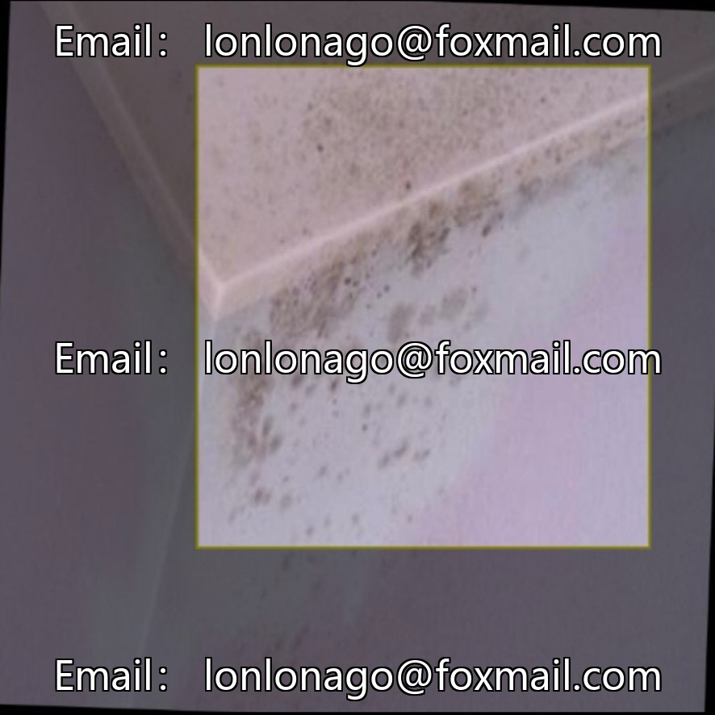
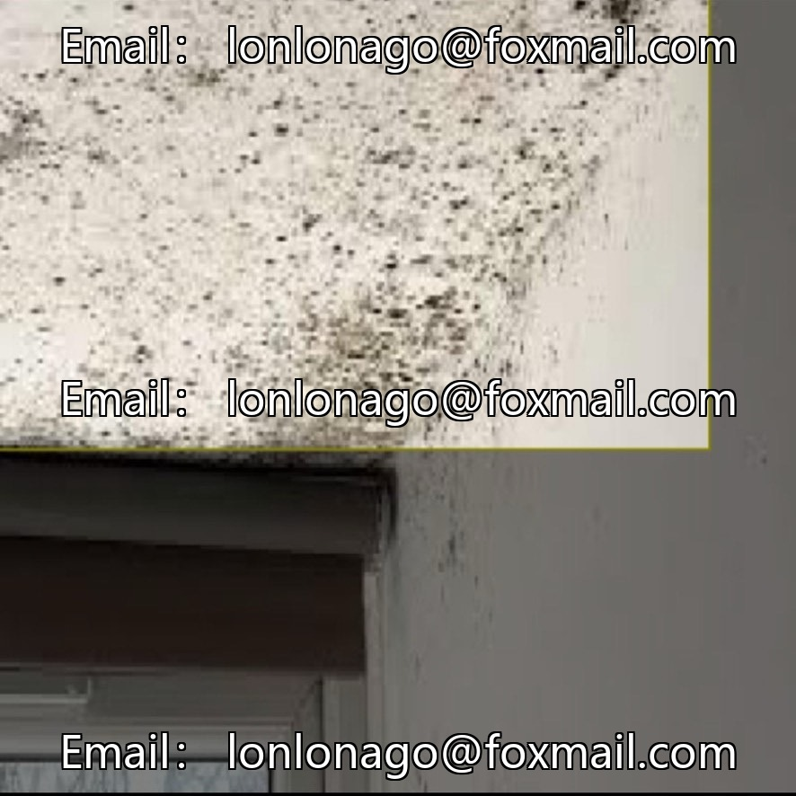
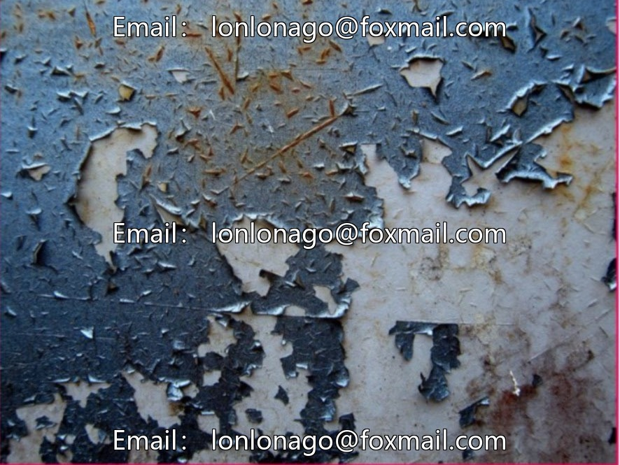
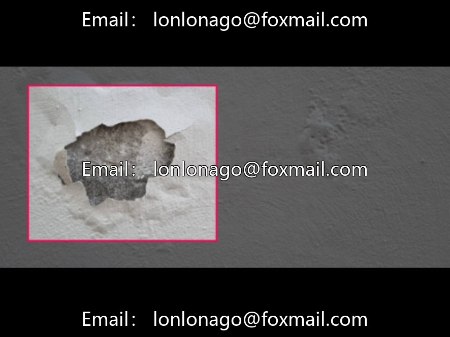

# Inner wall defect detection dataset

## Body

Building Wall Defect Detection Dataset - Quality Defect Detection Dataset for Interior Walls (Issue 10380)
3,200 images of interior wall defects, six common issues: paint dripping, peeling, pinholes, roughness, stains, and knife marks. YOLO format annotations are provided directly for target detection tasks. The categories are clearly defined with balanced distribution, suitable for scenarios such as building acceptance, home maintenance, intelligent quality inspection, and algorithm research.

Virtual materials, once sold, are non-refundable.
Interested friends, click "I want" to proceed.

## Images

## Payment

Here is a pay link on Stripe ( https://buy.stripe.com/3cs8yP7sY87d0vu9AB ). Please contact me lonlonago@foxmail.com after funding $89, and I will send you a complete data files , thank you!

